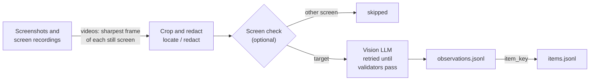

<h1 align="center">framelift</h1>

<div align="center">

Extract structured data from screen recordings and screenshots with vision LLMs.

[](https://pypi.org/project/framelift/)
[](https://pypi.org/project/framelift/)
[](https://github.com/rysk-tanaka/framelift/actions/workflows/ci.yml)
[](https://github.com/rysk-tanaka/framelift/blob/main/LICENSE)
[](https://github.com/astral-sh/uv)
[](https://github.com/astral-sh/ruff)
[](https://github.com/astral-sh/ty)

</div>

<p align="center">
  
</p>

You describe what to read as a Pydantic model and how to read it as a `Profile`;
framelift turns screenshots and screen recordings into validated, provenance-tagged JSON Lines.

> Status: pre-alpha (0.x). The public API is limited to `Profile` and `Pipeline`
> and may change between minor versions.

## How it works



## Features (0.6)

- Image and video input (files, directories, glob patterns), each tagged with its SHA-256
- Videos are read once per still screen: frames are sampled, scrolling frames are skipped, and the
  sharpest frame of each still screen is sent
- Structured extraction with [Pydantic AI](https://ai.pydantic.dev/): your model is the output type,
  your validators trigger automatic retries
- Model-agnostic: pass any `provider:model` string supported by Pydantic AI, with model settings
  such as turning off a local model's thinking
- Only the part of the screen you choose is sent: crop each orientation to a box and paint over
  areas such as a chat window before anything leaves your machine
- An optional screen check: images of other screens are skipped before extraction
- An optional cache, so a run or an evaluation repeated on the same images is not paid for again
- `observations.jsonl` output with source, frame, crop, usage and retry information per image or
  frame
- `items.jsonl`: list items seen in several frames merged by majority vote, with disagreements kept
- An evaluation harness built on [pydantic-evals](https://ai.pydantic.dev/evals/): score a profile
  and a model against images with expected outputs
- A synthetic sample generator (a fictional shop screen, still or scrolling) for demos and tests

## Install

```bash
pip install "framelift[anthropic]"   # or [openai], [google]
pip install "framelift[video,anthropic]"   # to read screen recordings too
```

## Quick start

```python
from pydantic import BaseModel, Field
from framelift import Pipeline, Profile


class ShopItem(BaseModel):
    name: str = Field(description="Item name as displayed")
    price: int = Field(description="Price as an integer", gt=0)


class ShopScreen(BaseModel):
    shop_name: str
    items: list[ShopItem]


shop = Profile(
    name="fantasy-shop",
    version="1",
    output_type=ShopScreen,
    instructions="Read the shop's item list exactly as displayed.",
    # Required: what to send. "full" sends the whole screen; boxes are (left, top, right, bottom)
    # as fractions of the upright screen, per orientation.
    locate={"portrait": (0.0, 0.0, 1.0, 0.6), "landscape": (0.0, 0.0, 1.0, 0.9)},
    redact=[(0.0, 0.0, 0.3, 0.05)],  # painted black before cropping, e.g. a player name
    item_key=lambda item: item.name,  # merges the same item across frames
)

Pipeline(shop, model="anthropic:<model-name>", out_dir="out").run(["shots/*.png", "scroll.mp4"])
```

Or from the command line:

```bash
framelift synth --out samples --n 3 --videos 1   # fictional shop screenshots and a scrolling video
framelift run samples --profile examples.fantasy_shop:profile \
  --model anthropic:<model-name> --out out
```

Each line of `out/observations.jsonl` is one image or video frame, with its source, crop, usage
and retries; see [Output](https://github.com/rysk-tanaka/framelift/blob/main/docs/guide/output.md) for every field.

## Guides

| Guide | What it covers |
| --- | --- |
| [Output](https://github.com/rysk-tanaka/framelift/blob/main/docs/guide/output.md) | `observations.jsonl` fields, frames, and inputs that cannot be read |
| [Videos and merged items](https://github.com/rysk-tanaka/framelift/blob/main/docs/guide/videos.md) | How still screens are picked from a recording, and `items.jsonl` |
| [What is sent](https://github.com/rysk-tanaka/framelift/blob/main/docs/guide/what-is-sent.md) | Cropping and redacting with `Profile.locate` and `Profile.redact` |
| [Screen check](https://github.com/rysk-tanaka/framelift/blob/main/docs/guide/screen-check.md) | Skipping menus and other screens before extraction |
| [Model settings](https://github.com/rysk-tanaka/framelift/blob/main/docs/guide/model-settings.md) | Sending Pydantic AI model settings, such as turning off thinking |
| [Cache](https://github.com/rysk-tanaka/framelift/blob/main/docs/guide/cache.md) | Not paying twice for the same images, and the local server check |
| [Evaluate](https://github.com/rysk-tanaka/framelift/blob/main/docs/guide/evaluate.md) | Scoring a profile and a model against images with expected outputs |

## Privacy

framelift runs locally and only sends the cropped and redacted images, from the files you pass
and the frames it picks from your videos, to the model provider you choose.
It has no telemetry. It writes only to the output and cache directories you give it.

## Development

```bash
uv sync --all-extras
uv run ruff check && uv run ruff format --check
uv run ty check
uv run pytest
```

Only the tests marked `live` call a real model; the others cannot (`ALLOW_MODEL_REQUESTS = False`).
The `live` tests are left out by default (`-m "not live"`). To run them, name the model in
`FRAMELIFT_LIVE_MODEL` and set the provider's API key. They read a few synthetic screens, so the
provider bills for them.

```bash
FRAMELIFT_LIVE_MODEL=anthropic:<model-name> uv run pytest -m live
```

## License

MIT
