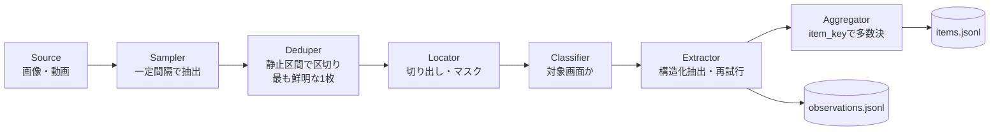

# framelift 設計書

## 概要

framelift は、画面収録やスクリーンショットから、利用者が定義したスキーマどおりの構造化データを取り出す Python ライブラリと CLI。読み取りには画像対応の LLM を使う。特定のゲームやアプリには依存しない。利用者は「何を読み取るか（Pydantic モデル）」と「どう読むか（指示と検証）」を `Profile` として渡すだけでよい。

ゲームの自動操作やクライアントへの介入は行わない。自分で撮った画面を後から読むだけのツール。最初の利用者は作者の別プロジェクト（非公開）で、0.x の間は、そこで実際に必要になった機能だけを入れる。

## 使い方のイメージ

1.0 時点の完成形のイメージ。今使えるのは `name`・`version`・`output_type`・`instructions`・`validators`・`item_key`・`locate`・`redact`・`screen_description` と、画像・動画の入力までで、それ以外の引数はコメントの版で足す。

```python
from pydantic import BaseModel, Field
from framelift import Profile, Pipeline


class ShopItem(BaseModel):
    name: str = Field(description="商品名")
    price: int = Field(description="価格（整数）", gt=0)


class ShopScreen(BaseModel):
    shop_name: str
    items: list[ShopItem]


shop = Profile(
    name="fantasy-shop",
    version="1",
    output_type=ShopScreen,
    instructions="ショップ画面の商品一覧を、表示どおりに読み取ってください。",
    screen_description="ショップの商品一覧画面",  # 0.3
    item_key=lambda item: item.name,
    # 送る範囲（必須）。"full" か、画面の向きごとの (left, top, right, bottom)
    locate={"portrait": (0.0, 0.1, 1.0, 0.85), "landscape": (0.2, 0.1, 0.8, 0.95)},
    redact=[(0.0, 0.85, 1.0, 1.0)],  # 送る前に塗りつぶす領域（画面全体に対する相対座標）
)

pipeline = Pipeline(shop, model="anthropic:<model>", out_dir="out/")
pipeline.run(["recording.mp4", "shots/*.png"])
# → out/observations.jsonl（フレーム単位）と out/items.jsonl（集約後）
```

```bash
framelift run recording.mp4 --profile myprofiles:shop --model anthropic:<model> --out out/
```

## 設計

### Profile — 唯一の拡張点

読み取り対象は `Profile` で定義する。項目は、それを使う機能と同じ版で足す。

| 項目 | 役割 | 版 |
| --- | --- | --- |
| `output_type` | 出力の Pydantic モデル。フィールドの説明はモデルへの指示として渡る | 0.0.1 |
| `instructions` | 読み方の指示 | 0.0.1 |
| `validators` | 出力を検査し、問題があれば `ModelRetry` を投げる関数。Pydantic AI の出力検証に登録し、再試行させる | 0.0.1 |
| `version` | 指示やモデル定義を変えたら上げる。キャッシュと評価結果の識別に使う | 0.0.1 |
| `item_key` | 一覧の各項目を同一視するキー。評価で正解の項目と対応付けるのと、複数フレームの集約に使う。`output_type` のトップレベルにある、ただ 1 つの `list[モデル]`（`\| None` も可）型のフィールドの要素に適用する | 0.1 |
| `screen_description` | 対象画面の説明（画面判定に使う） | 0.3 |
| `locate` / `redact` | 送る範囲（必須）と、送る前に塗りつぶす領域 | 0.3 |

公開 API として約束するのは、`Profile` と `Pipeline` の設定項目だけ。パイプラインの各段のインターフェースは、0.x の間は内部扱い（`framelift._internal`）にし、利用者から要望が出てから公開する。使われない拡張点を先に約束して、設計が固まらなくなるのを避けるため。

### パイプライン



実装済みなのは Source（画像・動画）、Sampler、Deduper、Locator（`full`・`fixed`）、Classifier、Extractor、Aggregator と、`observations.jsonl`・`items.jsonl` の書き出し。

#### 入力

画像ファイル群と動画ファイルを受け付ける。動画は拡張子（`.mp4`・`.mov`・`.m4v`・`.mkv`・`.webm`）で見分け、PyAV でデコードする。PyAV は wheel に FFmpeg が同梱されているので、利用者に FFmpeg の別途インストールを求めずに済み、合成動画でのテストもしやすい。動画入力は `framelift[video]` の extras に分け、画像だけを使う人の依存を軽くする。動画があるのに extra がなければ、モデルを呼ぶ前に案内付きで止める。各入力の sha256 を計算し、出所として記録する。動画はファイル全体を読み込まず、少しずつ読んで計算する。動画のハッシュはデコードの前に計算し、デコードしたあとに照合し直さないので、その間にファイルが差し替えられると、記録した sha256 とデコードした中身が食い違う。

#### フレーム抽出と重複除去

シーン検出フィルタには頼らず、一定間隔（既定は毎秒 4 フレーム、`frame_rate`）で標本を取り、画面が止まっている間を 1 つの区間にまとめる。区間の中から、ラプラシアン分散が最大の、つまり最もブレていない標本を代表に選び、モデルに送る。スクロール中のブレたフレームを抽出に回さないため。

- 静止の判定には、標本を 256×256 のグレースケールに縮小し、16×16 のタイルに分けて、平均絶対差が 3（0〜255）を超えたタイルの割合を使う。直前の標本との割合と、区間の先頭の標本との割合がどちらも `motion_threshold`（既定 0.05）以下なら同じ区間に加え、どちらかが超えたら区間を切る。先頭とも比べるのは、ゆっくりしたスクロールは隣どうしの差が小さいまま画面が入れ替わるため
- 画面全体の平均ではなく、変化したタイルの割合で判定するのは、配置が同じで文字だけが変わる切り替わりを見逃さないため。行の背景の縞がそろう行数のスクロールや、ページ・タブの切り替えがこれに当たる。全体の平均だと、文字の差が平均の中に埋もれてしまう。一方、隅の小さなアニメーションや時計、1 行だけの書き換えは変化したタイルが少ないので、静止の区間を切らない。合成画面では、行単位のスクロールやページの入れ替えで 10% 以上のタイルが変わり、符号化ノイズ・小さなアニメーション・1 行の書き換えは 2% 未満だった
- pHash は、少しずれた画面やブレた画面も近いと判定するので、静止の判定には使わない。移動を挟んだ 2 つの静止区間は、pHash が近くても別の区間として扱う。pHash は観測記録に残すためだけに計算する
- 標本が 2 つ未満の区間（移動中の単独の標本など）は捨てる。このため、標本が 2 つ以上入らないほど短く表示された画面は読まれない
- 数ピクセルのずれでも文字がタイルをまたいで動くので、ゆっくりしたスクロールも動きとして扱い、その間の標本は読まない。止まらずに動き続ける画面は、動画全体で最も鮮明な標本 1 枚だけになる（下記）ので、読みたい画面では指を止める
- 最後のフレームは、動画の終わりまで表示されているものとして数える。終わりの時刻は、フレームの長さ、ストリームの長さ、コンテナの長さの順に取る。画面が変わったときだけフレームを書く可変フレームレートの録画では、最後の静止画面がフレーム 1 枚になるため
- 静止区間が 1 つもない動画は、最も鮮明な標本を 1 枚だけ読む
- 動画の表示回転（`frame.rotation`）を適用してから判定し、送る
- 区間を閉じたらすぐ代表を渡すので、長い動画でもメモリの使用量は一定になる
- モデルを呼ばずに代表フレームだけを確かめる `framelift frames` を用意する

#### 画面判定

`Profile.screen_description` があるとき、抽出の前に、送る画像が対象画面かどうか（bool）と確信度をモデルに返させる。対象でない画面は抽出に回さない。

- 判定には、切り出し・塗りつぶし後の画像を長辺 512px 以下に縮小した PNG を送る。判定に細部は要らず、トークンを抑えられるため。切り出す前の画面全体を送ると、切り出しで外した領域まで外部に送ることになるので、図の順のとおり、切り出しの後に判定する
- 元のバイト列をそのまま送る静止画でも、判定には EXIF の向きと色空間を正規化した画像を使う。元の JPEG のままでは、横倒しの画像が判定に送られ、CMYK の画像は PNG に保存できないため
- 判定のモデルは `Pipeline(screen_model=...)`（CLI は `run --screen-model`）で分けられ、省略すると抽出と同じモデルを使う。モデルの設定（`Pipeline(model_settings=...)`、CLI は `--model-setting`）は判定にも送る。考えてから答えるローカルのモデルでは、判定 1 回に数分かかることがあり、判定こそ考える処理を切りたいため。判定の出力には `screen_check` という名前を付け、抽出（既定の `final_result`）と見分けられるようにする
- 判定は、モデルが JSON スキーマに沿った出力に対応していればその形で答えさせ（Pydantic AI の `NativeOutput`）、対応していなければツール呼び出しで答えさせる（0.7）。ツール呼び出しでは、考える処理を切ったローカルのモデル（Qwen3.6 35B-A3B）が、ツールを呼ぶ前に判定理由の説明文を最大 1000 文字ほど書き、出力が 41〜332 トークン、1 回 7〜87 秒になった。指示で「ツールだけを呼ぶ」と頼んでも減らなかった。スキーマに沿った出力では説明文を書く余地がなく、同じ画像で毎回 16 トークン、2〜13 秒で、答えは変わらなかった
- 抽出はツール呼び出しのままにする。同じモデルで抽出には説明文を書かず、スキーマに沿った出力にすると、一覧の各行に 1 行目の値を写す誤りが出たため
- 対象でないと判定した画像は `status: "skipped"` の観測にする。`skipped` は失敗ではないので、終了コードは変えない。集約は `ok` の観測だけを使うので、票にもならない
- 再試行しても判定の応答が検証を通らなかった画像は、推測で抽出せず `status: "error"` にする
- 判定のトークンは抽出の `usage` と分けて、観測の `screen.usage` に残す。判定に失敗した場合も残すので、判定にかかったコストが見える
- `screen_description` は、どの画像を読むかを決めるだけで、読み取る内容には影響しないので、`Profile.fingerprint` に入れない
- 評価では判定をしない。データセットのケースは対象画面だけで、評価は抽出の精度を測るため
- テンプレート照合など、LLM を使わない判定関数への差し替えは、要望が出てから入れる

#### 切り出しと塗りつぶし

外部に送る前に、`redact` で指定した領域を塗りつぶし、`locate` で指定した範囲だけを切り出す。`locate` は必須にし、画面全体を送るときも `"full"` と明示させる。既定の送信ポリシーを「切り出し後の画像のみ」にするため。

| 戦略 | 内容 |
| --- | --- |
| `full` | 切り出さない。画面全体を送るので、明示的に指定したときだけ使える |
| `fixed` | 画面の向き（縦・横）ごとに、相対座標で切り出す。`{"portrait": box, "landscape": box}` で渡し、片方だけでもよい |

- 座標は `(left, top, right, bottom)` で、表示どおりの向きにした画面全体に対する 0〜1 の相対座標。動画は表示回転、静止画は EXIF の Orientation（回転と反転）を適用してから数える。適用しないと、EXIF で縦向きに表示される写真が横向きと判定され、塗りつぶしが別の領域に当たる
- 向きは、高さが幅より大きければ縦（`portrait`）、そうでなければ横（`landscape`）
- `redact` は向きによらない一覧か、向きごとの一覧で渡す。座標は切り出す前の画面全体に対するもので、切り出しの前に不透明な黒で塗る。透過のある画像（透過色を指定した PNG を含む）も、塗った領域は透明にならない
- ピクセルへの換算は外側に丸める。塗りつぶしは指定した範囲を必ず覆い、切り出しは 1 ピクセル以上になる。ただし、ピクセルの境界に浮動小数点の誤差の範囲で重なる辺は、その境界に合わせる。`0.07 * 100` は `7.000000000000001` になり、切り上げると範囲外の 1 行まで送ってしまうため
- 16 ビットのグレースケール PNG は 8 ビットに縮めてから加工する。Pillow はそのまま RGB にすると値を縮めずに打ち切り、画面が白くなるため
- 向きに合う範囲が `fixed` にない画面は送らず、`status: "error"`・`frame: null` の観測として記録して次へ進む。`crop` には向きだけを残す
- 画面全体を塗りつぶしも切り出しもせずに送る（`full` で `redact` がない）ときは、静止画の元のバイト列をそのまま送る。それ以外は、加工した画像を PNG にして送る
- 動画の静止の判定と鮮明さは、表示どおりの向きにした輝度を、送る範囲で切り出してから測る（0.5）。送らない部分の動き、たとえば読み取る一覧の横でキャラクターが待機中に動くと、一覧が変わらないのに静止区間が切れ、同じ画面を何度もモデルに送ってしまうため。向きに合う範囲がない画面は画面全体で測り、選んだフレームを切り出せない観測として記録する。代表フレームは画面全体のまま選び、送るときに切り出しと塗りつぶしを適用する
  - 塗りつぶしが半分以上のタイルは、変化したタイルの割合の分母から外し、残りのタイルの変化は塗りつぶしていない画素だけで平均する。分母に入れると、塗りつぶしが広いほど割合の上限が下がり、画面が切り替わっても閾値を超えず、読み逃すため
  - 鮮明さ（ラプラシアンの分散）は、上下左右と自身がどれも塗りつぶしていない画素だけで測る。塗りつぶしの縁の強い輪郭が分散の大半を占め、ぼけた標本と鮮明な標本の差が埋もれるため。測れる画素がない切り出し（高さか幅が 3 画素未満など）は 0 にする
  - 縮小後の大きさは、各辺で 256 と、切り出しの辺を 16 の倍数に切り下げた値（最小 16）の小さいほうにする。小さな切り出しを 256×256 に引き伸ばすと、1 タイルあたりの元の画素が減ってノイズが平均されず、画面全体で合わせた閾値が合わなくなるため
- 評価でも同じ切り出しと塗りつぶしを適用し、実行時と同じ画像を送る
- `framelift frames --profile` で、モデルを呼ばずに送る画像を確かめられる。スクリーンショットも渡せる
- 範囲は画面に対する割合で、画面を区別するのは向きだけなので、縦横比の違う端末（細長いスマホとタブレットなど）や、黒帯・ノッチのある録画では、同じ割合が別の位置に当たる。塗りつぶしがずれてもエラーにはならず、隠したかった領域が送られる。そのため、画面を撮る端末ごとに一度 `framelift frames --profile` で送る画像を確かめ、配置が大きく違う端末は Profile を分ける、とドキュメントに書く。観測記録の `crop.size` に画面の寸法を残すので、想定外の縦横比の画面が混ざっても後から見つけられる。想定外の縦横比の画面を送らない仕組みは、複数の端末で使うことがはっきりしてから検討する

縮小した画面から bbox をモデルに返させて切り出す `model` 戦略は、要望が出てから入れる。bbox を得るために画面全体を（縮小して）プロバイダに送るので、「切り出し後の画像だけを送る」と両立しないため。

#### 構造化抽出

Pydantic AI の `Agent` に、`output_type` と切り出した画像（`BinaryContent`）を渡す。`validators` は出力検証として登録し、`ModelRetry` で再試行させる（上限回数は `Pipeline` の `max_retries`）。再試行を使い切った画像は `status: "error"` として記録し、1 枚の失敗で全体は止めない。読めない画像・動画も `status: "error"`、`frame: null` の観測として記録して次の入力へ進み、壊れる前に読めたフレームの結果は残す。途中で壊れている動画、フレームが 1 つもない動画、権限がない・途中で消えたなどでファイルを開けないものもこれに含む。ファイルを開けなければ `source.sha256` も null にする。モデルは `"provider:model"` の文字列で指定し、差し替えられる。トークン使用量と処理時間を記録する。

ローカルのサーバーでは、応答のモデル名が指定したモデル名で始まっているかを、大文字と小文字を区別せずに確かめ、始まっていなければ `UserError` で実行を止める。LM Studio のように、持っていないモデルを指定されると読み込み済みの別のモデルで答えるサーバーがあり、その答えが指定したモデルの観測とキャッシュに残るため。ローカルのサーバーは、プロバイダが `openai` で、接続先のホストが `localhost`、プライベートのアドレス、Tailscale のアドレス（100.64.0.0/10）、ドットのない名前（`m6m` など）、`.local`・`.lan`・`.home.arpa`・`.ts.net` で終わる名前のものを指す。`.internal` は入れない。クラウドや社内の基盤が、ゲートウェイを含む自前のサービスにこの名前を付けるため。ほかの接続先は確かめない。OpenAI は別名に日付付きの名前で、Azure はデプロイ名の指定に実際のモデル名で、Google やゲートウェイは別名に実際のモデル名で答えるので、正しい設定でも名前が前方一致しない。以前は OpenAI 本家・Azure・既知のゲートウェイを除いたすべての接続先を確かめていたが、独自ドメインの Azure や Azure 上の自前のサーバーなど、外しすぎ・外し足りない例がなくならなかった。困っているのは手元のサーバーなので、そこに絞る。応答がどの内側のモデルから来たかを区別できない `FallbackModel` も確かめない。完全一致にしないのは、別名に日付付きの名前で答えるサーバーがあるため。発行元を付けたり外したりして答える（`openai/gpt-oss-20b`）サーバーや、モデルのファイルのパスで答えるサーバーもあるので、どちらの名前も最後の `/`（Windows のパスなら `\`）より後で比べる。LM Studio で量子化を付けた指定（`qwen3-vl-8b@q4_k_m`）は、`@` より前で比べる。応答の名前が空のときは、名前がないときと同じく確かめない。応答ごとに確かめるので、別のモデルが答えたと分かった後の再試行には課金しない。1 枚の読み誤りと違い、設定の誤りで全部の画像が同じように誤るので、観測にせず止める。エラーには、見つかった入力のパスを添える（パスを匿名化しているときは sha256）。動画なら、フレームの番号と時刻も添える。それより前に書いた観測を信用してよいかを、利用者が判断できるようにするため。Pydantic AI がストリームで問い合わせる場合（capability を付けた実行など）も、読み終えた応答で確かめる。CLI はこのエラーを、終了コード 2 の短いメッセージにする。評価でも、pydantic-evals がケースの失敗として受け止めるだけにはせず、後のケースを送らずに、評価の後で同じエラーを、見つかった画像のパスを添えて投げる。ローカルのホストで動くプロキシは確かめる対象になる。コンテナ名で指した LiteLLM のように、別名に実際のモデル名で答えるローカルのプロキシは、`openai-chat:` と `OPENAI_BASE_URL` ではなく、専用のプロバイダ（`litellm:`）で指定すれば確かめない。エラーメッセージには、サーバーでモデルを読み込む・サーバーでの名前で指定する・プロキシは専用のプロバイダで指定する、という直し方を書く。

#### キャッシュ

`Pipeline(cache_dir=...)`（CLI は `run --cache DIR`・`eval --cache DIR`）を指定したときだけ、抽出と画面判定の結果をそのディレクトリにキャッシュし、再実行や評価の繰り返しで同じ画像に課金しない。読み取った内容を、利用者の知らない場所に残さないため、既定では無効にする。

- 抽出のキーは「送る画像の sha256・モデルの文字列・接続先の URL・モデルの設定・`Profile.fingerprint`」、画面判定のキーは「判定に送る縮小画像の sha256・モデルの文字列・接続先の URL・モデルの設定・`screen_description`・`Profile.version`」で、スキーマに沿った出力（`NativeOutput`）で聞くときだけ、その旨を足す。切り出し範囲を変えると送る画像が変わるので、キーも変わる。判定のキーに `Profile.version` を入れるのは、版を上げれば判定もやり直せるようにするため。説明文を変えずに、誤った判定をやり直す手段がほかにない
- どちらのキーにも `CACHE_REVISION` を入れる。framelift 自身のプロンプト・判定の指示文と出力・エントリの形式を変えたらこれを上げ、古い版で作ったエントリを使わない
- 変更が一部の結果にしか及ばないときは、`CACHE_REVISION` を上げる代わりに、その結果のキーに項目を足す。上げると、変わっていない結果まで聞き直して課金されるため。判定をスキーマに沿った出力で聞くようにしたときは、そう聞くモデルのキーにだけ足し、ツール呼び出しのままのモデルは以前のエントリを使い続ける
- モデルの文字列（`"anthropic:<model>"` など）にはプロバイダと API の種類が含まれるが、接続先は含まれない。`OPENAI_BASE_URL` で LM Studio などの OpenAI 互換サーバーを指すと、同じ文字列で別のサーバーに問い合わせられる。そのため、モデルを構築時に解決し、その `base_url` もキーに入れる。URL はハッシュしてから入るので、URL に認証情報があってもキャッシュには出ない。認証を環境変数で変えた違いはキーに入らない
- 多くのプロバイダは、モデルを解決するときに API キーを求める。そのため、全部の画像がキャッシュにある実行でも API キーが要る。`OPENAI_BASE_URL` を設定した `openai` のプロバイダは、API キーがなくても解決できるので要らない
- モデルの設定は、考える処理の有無などで答えを変えるので、JSON にしたハッシュをキーに入れる。設定がないときは何も足さず、設定を渡せるようになる前のエントリをそのまま使う。JSON にできない設定（`httpx.Timeout` など）はキャッシュせず、警告を 1 回出す
- `Model` のインスタンスで渡したモデルはキャッシュせず、警告を 1 回出す。設定・プロファイル・内側のモデル・HTTP クライアントなど、答えを変える構成を外から確実に見分けられないため。CLI の `--model` は常に文字列なので、CLI では常に使える
- 検証を通った抽出と、成功した判定だけを書く。失敗は次の実行で成功しうるので書かない
- `max_retries` はキーに入れず、エントリに元の再試行回数を残す。今の `max_retries` より多く再試行して通ったエントリは使わない。上限を下げた評価で、上限を超えて通った結果を成功に数えないため
- 抽出結果は、出力モデルのフィールド名で、設定されたフィールドだけを JSON にして残し、ヒットしたら出力モデルで検証し直して復元する。`Field(exclude=True)` のフィールドと private 属性は書かないので、観測記録に出さない値はディスクにも残らない
- 書く前に、その JSON から復元したモデルが元のモデルと厳密に同じ状態か（型・設定されたフィールド・除外フィールド・extra・private 属性。`False` と `0` も区別する）を確かめ、同じときだけ書く。冪等でないバリデータ、除外フィールドや private 属性に値を持つモデル、`Profile.validators` が項目を派生型に差し替えるモデル、NaN を含むモデルは、キャッシュが効かないが結果は正しい。こうして、ヒットしたときの `data`・項目・`item_key` のキーは、課金した実行と同じになる
- ヒットしたら、観測記録の `data` の sha256 をエントリと照合し、ライブラリの更新でシリアライズが変わったなどで合わなければ、読めない・壊れたエントリと同じくミスとして抽出し直す
- バリデータは同じ入力に同じ結果を返すものとする。`validators` はコードなので `fingerprint` に入らない。バリデータを変えたら `Profile.version` を上げる
- ヒットした観測は `cached: true`（判定は `screen.cached`）で、`usage`・`retries`・`latency_ms` は元の実行のものを残す。評価でキャッシュしたケースのコストが 0 に見えて、モデルどうしの比較が狂わないようにするため
- エントリは `cache_dir/<extract|screen>/<キーの先頭 2 文字>/<キー>.json`。一時ファイルに書いて置き換えるので、途中で止まっても壊れたエントリが残らない。書き込みに失敗したら警告を 1 回出して実行を続ける。結果は得ていて、課金も済んでいるため
- 古いエントリは消さない。不要になったらディレクトリごと消す

#### 集約

スクロールした一覧では、同じ項目が複数のフレームに映る。1 回の実行の、検証を通ったすべての観測（動画・静止画をまたぐ）から、`item_key` で項目を束ね、多数決を取る。各項目には根拠になったフレームの一覧を付け、1 枚にしか映らなかった項目は `votes: 1` で区別できるようにする。

- `votes` は項目が映ったフレームの数。1 フレームに同じキーが 2 回あれば、最初の 1 つだけを使う
- キーは JSON にした形で束ねる。`Enum` とその値のように、JSON にすると同じになるキーは 1 つの項目になる。JSON にできないキーは `str(key)` で書き出すが、束ねるのはキーそのもので行う。文字列にすると同じになるだけの別のキーを 1 つにまとめないため
- 項目の値は、観測記録と同じく出力モデル自身のシリアライズ設定で書く。別名（alias）で書き出すモデルなら、`items.jsonl` も別名になる
- `item_key` が例外を投げた項目は集約から外し、件数を `RunResult.unkeyed_items` に数える。正常に返した `None` は有効なキー
- 項目がすべて dict ならフィールドごとに、そうでなければ（`RootModel` の項目など）項目全体で投票する。フィールドがない観測は棄権し、明示的な `null` は 1 票に数える
- 最多票が同数で並んだら決め打ちせず、そのフィールドを null にする。値が 2 種類以上あったものは、最多票が決まった場合も `conflicts` に全候補と票数を残す（票数の多い順、同数なら値の順）
- `item_key` がない `Profile` では集約しない
- モデルの呼び出しが検証の失敗以外のエラー（プロバイダの拒否など）で止まった場合も、それまでに読んだ分の `items.jsonl` を書いてから例外を投げる。`observations.jsonl` と同じく、途中までの結果を残すため

### 出力形式

スキーマにはバージョンを付ける。形式を変えるときは版（`v1` の部分）を上げる。

`observations.jsonl`（画像・フレーム単位）は `framelift/observation/v3`。0.2 の v2 では、`source.phash` を、モデルに送った画像を表す `frame` に移した。0.3 の v3 では、送った画像をどう切り出したかを表す `crop` と、画面判定の結果を表す `screen` を足し、`status` に `skipped` を加えた。

```jsonc
{"schema": "framelift/observation/v3",
 "status": "ok",
 "profile": {"name": "fantasy-shop", "version": "1"},
 "source": {"path": "recording.mp4", "sha256": "..."},
 "frame": {"index": 3, "timestamp_ms": 2250, "sha256": "...", "phash": "..."},
 "crop": {"orientation": "portrait", "size": [1170, 2532], "bbox": [0.0, 0.1, 1.0, 0.85], "redact": [[0.0, 0.85, 1.0, 1.0]]},
 "screen": {"is_target": true, "confidence": 0.93, "model": "anthropic:<model>",
            "usage": {"input_tokens": 410, "output_tokens": 24, "requests": 1, "latency_ms": 640},
            "error": null, "cached": false},
 "cached": false,
 "data": {"shop_name": "...", "items": [...]},
 "error": null,
 "model": "anthropic:<model>",
 "usage": {"input_tokens": 1534, "output_tokens": 96, "requests": 1, "latency_ms": 2100},
 "retries": 0}
```

- `source` は入力ファイル（画像か動画）
- `frame` はモデルに送った画像（切り出し・塗りつぶしの後）。`index` は入力ファイル内で選んだフレームの通し番号、`sha256` と `phash` は送った画像のもの
- `timestamp_ms` はストリームの先頭からの時間。開始時刻が 0 でない mov・mkv・webm でも、最初のフレームが 0 近くになる
- 静止画では `index: 0`、`timestamp_ms: null`。`full` で塗りつぶしもなく、元のバイト列をそのまま送ったときだけ、`frame.sha256` は `source.sha256` と同じになる
- `crop` の `size` は、表示どおりの向きにした画面の切り出す前の寸法（ピクセル）。`bbox` は切り出した範囲で、`full` なら `[0, 0, 1, 1]`。`redact` は実際に塗りつぶした領域
- `screen` は画面判定の結果で、`screen_description` がないとき、または何も送らなかったときは null。判定に失敗したときは `is_target` と `confidence` が null で、`error` に理由が入る
- `cached` は抽出をキャッシュから読んだかどうか。`true` でも、`usage` と `retries` は元の実行のもの
- `status` は `ok`・`skipped`（判定で対象外とした）・`error` のどれか。`skipped` では `data` と `error` が null で、抽出の `usage` は 0
- 入力そのものを読めなかったときは、何も送っていないので `frame` と `crop` は null。向きに合う切り出し範囲がなかったときは、`frame` は null で、`crop` には `orientation` だけを入れ、`bbox` を null にする

v3 は 0.3.0 で初めてリリースする。0.3 の画面判定（`screen`・`skipped`）とキャッシュ（`cached`）も v3 に項目を足すが、v3 を書くリリースがまだないので、そのたびに版は上げない。

`items.jsonl`（集約後）は 0.2 で入れた。`Profile.item_key` があるときだけ書く。

```jsonc
{"schema": "framelift/item/v1", "key": "Moon Herb",
 "data": {"name": "Moon Herb", "price": 120}, "votes": 3,
 "conflicts": [{"field": "price", "values": [{"value": 120, "votes": 2}, {"value": 12, "votes": 1}]}],
 "evidence": [{"source_sha256": "...", "frame_index": 1, "timestamp_ms": 2250},
              {"source_sha256": "...", "frame_index": 2, "timestamp_ms": 5300},
              {"source_sha256": "...", "frame_index": 3, "timestamp_ms": 8100}]}
```

`conflicts` の `field` は、項目全体で投票したときは null になる。`evidence` は票を入れたフレームごとに 1 件で、件数は常に `votes` と同じ。パスは入れず、ハッシュだけを残す。

出力時に、パスを落として sha256 だけを残す匿名化を選べる（`Pipeline(anonymize_paths=True)`）。読めない入力のエラー文も、パスを含めずに原因だけを書く（「Not a readable image (No such file or directory)」など）。パスを置換で消す方式だと、エスケープされた形のパスが残り、短いパスでは文言まで書き換えてしまうため。

### 評価ハーネス

`pydantic-evals` の上に、画像と正解のデータセット形式、評価器、設定の総当たり比較を用意する（`framelift[eval]`）。データセット形式と評価器は 0.1 で実装済み。

- データセット — YAML で書く。各ケースは、画像（データセットのルートからの相対パス）、sha256、正解（必須フィールドはすべて書く。既定値のあるフィールドは省いてよい）、メタデータ（画面の向き・端末・解像度など）を持つ。画像のパスはデータセットファイルのディレクトリからの相対で、`--root` で別のディレクトリを指せるので、画像をリポジトリに置かない運用ができる。あるデータセット用に設定したルートが別のデータセットにも気づかれないまま効いてしまうので、環境変数は使わない。実行前に全画像を読み込み、画像として読めることと sha256（大文字・小文字は区別しない）を照合し、問題はまとめて報告する
- 評価器 — 下の表のとおり。結果は pydantic-evals のレポートとして端末に出す
- 総当たり比較（要望が出てから） — `matrix.yaml` で「モデル×切り出し戦略×指示の版」を総当たりで実行し、比較表を Markdown で出力する。README にそのまま貼れる形にする
- 評価でも `Profile` の `locate` と `redact` を適用し、実行時と同じ画像を送る。データセットのケースは対象画面だけで、評価は抽出の精度を測るので、画面判定はしない。画像の差し替えの検出は、送る画像ではなく入力ファイルのハッシュで行う。向きに合う切り出し範囲がないケースは、抽出に失敗したケースと同じく 0 点にする

```yaml
schema: framelift/dataset/v1
cases:
  - name: shop-000
    image: shop-000.png
    sha256: 3dbb5bc8...
    expected:
      shop_name: Amber Market
      items:
        - {name: Dew Rope, price: 1590}
    metadata: {orientation: portrait, width: 720, height: 1280}
```

| 評価器 | 内容 |
| --- | --- |
| `ValidationPassed` | 再試行の上限までに検証を通ったか（検証の通過率） |
| `FieldAccuracy` | 正解に書いたフィールドだけを葉の値で比べた一致率。一覧は `item_key` で対応付けた項目どうしを比べ（同じキーの項目は出現順に対応付ける）、出力にない項目の値は不一致と数える。`item_key` がないとき、または正解が空の一覧のときは、一覧全体を 1 つの値とし、位置ごとに正解に書いたフィールドを比べる。不一致のパスを理由に残す |
| `item_precision` / `item_recall` | 一覧項目の適合率と再現率（`item_key` で正解と対応付け）。`item_key` があり、正解に一覧があるときだけ出す |
| `input_tokens` / `output_tokens` / `latency_ms` / `retries` | コストと処理時間。コストはトークン量で比べ、金額には換算しない |

正解は実行前に `output_type` 全体で（バリデータ・シリアライザ・設定も含めて）検証し、出力と同じ JSON 形式に揃える。必須フィールドはすべて書き、既定値のあるフィールドだけ省いてよく、省いたフィールドは比べない。出力に含まれない `Field(exclude=True)` のトップレベルのフィールドは、検証には使うが比べない。必須フィールドを省けないのは、一部だけの正解には出力モデルのバリデータや設定を正しく適用できず、出力側と値やキーが食い違うため。足りない必須フィールド、型の合わない値（引用符のない YAML の `no` が `False` になる場合など）、モデルバリデータが拒否する値、出力に現れないキー（誤記・未知のフィールド・入れ子の除外フィールド。Union や `extra="allow"` のモデルも、検証後の出力を書き出した形で判定する）、`item_key` が例外を出す項目は、データセットのエラーとして実行前にまとめて報告する。抽出した項目で `item_key` が例外を出した場合は、評価を止めず、どの正解とも対応しない項目として数える。一覧のシリアライザが並べ替えてもキーと値がずれないよう、一覧の項目はキーも値もそれぞれの項目のモデルから取る。Python では `False == 0` が成り立つので、値の比較では真偽値と数値を別の値として扱う。実行中は、抽出の直前に読んだ画像の sha256 をもう一度照合し、照合後に差し替わった画像はそのケースの失敗にする。

検証を通らなかったケースは、`FieldAccuracy` と適合率・再現率を 0 とする。抽出は pydantic-evals のイベントループ上で非同期に実行し、コストとプロバイダのレート制限を読みやすくするため、ケースは 1 件ずつ順に処理する。失敗の多いモデルが安く見えないよう、検証を通らなかったケースも使ったトークン量と再試行回数を記録する。`framelift eval` は、ケースや評価器が異常終了したときだけ終了コード 1 で終わり、スコアが低いだけなら 0 で終わる。

### 合成サンプル

架空のショップ画面を Pillow で描画し、画像・動画・正解を自動で生成する（`framelift synth`）。架空の店名・商品名・価格で一覧 UI を描き、画面の向きとスクロールを変えられる。画像の正解は評価にそのまま使える `dataset.yaml` として書き出す。

静止画は、実際のスクリーンショットに近い劣化を加えて書き出せる（0.4）。端末で撮った画面が送られるときに圧縮される順に合わせ、次の順で適用する。値は全画像に共通で、画像ごとにばらつかせる指定は要望が出てから入れる。

1. `--scale`（0.1〜4）で拡大・縮小する。0.1 より小さいと文字が読めず、さらにずっと小さい倍率では辺が 0 ピクセルに丸められる
2. `--noise`（0〜64）を標準偏差とするガウスノイズを、0〜255 の画素値に足す
3. `--jpeg-quality`（1〜95）を指定すると、PNG ではなく JPEG で保存する

正解は `--seed` だけで決まり、劣化の指定では変わらない。ノイズの乱数は、正解を決める乱数とは別の列から取る。既定値では、画像も `dataset.yaml` も劣化を加える前と同じバイト列を書く。`dataset.yaml` のメタデータには実際の寸法を書き、劣化の指定は既定値と違うものだけを残す。動画には劣化を加えない。

synth は、書いたスクリーンショットと動画を sha256 とともに `synth.sha256`（`sha256sum` と同じ行の形。下記のとおり、生成の途中では同じ名前の行が 2 つになることがあり、そのときは `sha256sum -c` で照合できない）に記録する。同じ出力先に生成し直すと、前の `synth.sha256` に載っていて、中身がその sha256 と一致し、今回書かなかったファイル（別の形式のもの、今回の `--n` や `--videos` より後の番号のもの）を消す。残すと、ディレクトリを `run` に渡したときに、`dataset.yaml` にない古い画像も読まれるため。

- 記録を `dataset.yaml` と分けるのは、利用者が自分の画像で書いた `dataset.yaml` を、synth が書いたものの一覧と取り違えないため。記録のない出力先（0.4 より前の synth が書いたものを含む）では何も消さない
- 中身を照合するので、利用者が差し替えたファイルは消さない。記録に載る名前は synth が付ける形（`shop-000.png`・`shop-scroll-000.mp4` など）に限るので、出力先の外は指せない
- `--videos 0`（既定）で生成し直すときは、前の動画と、その記録の行を残す。スクリーンショットだけを作り直しても、動画は消えない。利用者が消した動画の行は落とす
- 消せなかったファイルは、CLI のほかのメッセージと同じく標準エラーに出す。記録に残すので、次の実行で消し直す

すべてのファイルは、まず出力先の中の一時ディレクトリ（`.synth-` で始まる）に書き、書き終えてから出力先へ移す。描画や書き込みの途中で失敗したり止められたりしても、出力先は前のまま変わらない。その代わり、生成し直す間は前のファイルと新しいファイルの両方がディスクに載るので、出力先の大きさの分だけ空き容量が要る。動画が要る（`--videos` が 1 以上）のに PyAV がないときは、描画を始める前に止まる。

移すときは、今回書いたファイルと、これから消す前のファイルの両方を載せた `synth.sha256` を最初に移し、消し終えてから、今回書いたファイルと消せなかったものだけを残した記録に置き換える。この置き換えに失敗しても、最初の記録がすべてを載せているので、実行は失敗にしない。最初の記録には、今回も書く名前について前と今回の両方の sha256 を載せる（同じ名前の行が 2 つになる）。まだ移していない前のファイルも、記録と合うようにするため。移すのは同じファイルシステム内の名前の付け替えなので、ほぼ一瞬で終わる。ただし 1 ファイルずつ移すので、その最中や消している最中に止まったり失敗したりすると、前の画像と新しい画像が並んで残り、前の `dataset.yaml` と合わない画像も残りうる。どのファイルも記録には載っているので、もう一度生成すれば片付く。

動画（`--videos N`）は横向きの画面で、一覧の表示領域は 6 行分の高さで、行が途中で切れない。静止（1.5 秒）と 3 行分のスクロール（0.6 秒、ブレを再現）を最下部まで繰り返すので、隣り合う静止画面には同じ項目が映る。動画の評価は要望が出てから入れるので、動画の正解ファイルは書かない。テストでは生成関数が返す、静止区間ごとの表示項目を使う。

正解が自動で得られるので、公開できる評価データセットとして使える。README には合成データでのベンチマークを載せ、実際の画面での結果は「非公開のデータセットでの集計」として補足する。テスト用の合成動画（スクロールするショップ画面）も同じ生成器で作る。リポジトリに置くサンプル画像は少数（`samples/`）に限り、それ以外は生成スクリプトで再現する。

### プライバシー

処理はローカルで行い、外部に送るのは切り出しと塗りつぶしを済ませた画像だけ。既定の送信ポリシーも「切り出し後の画像のみ」にする。画面には、チャットや他のプレイヤー名など、無関係な個人情報が映るため。`Profile.locate` は必須で、画面全体を送るのは `"full"` と明示したときだけ。テレメトリは持たない。Logfire は任意の依存で、既定では無効。キャッシュは `cache_dir` を指定したときだけ、そのディレクトリに書き、出力も指定したディレクトリにだけ書く。

### テスト

- テストでは `models.ALLOW_MODEL_REQUESTS = False` を設定し、実際のモデルへのリクエストを禁止する
- モデルは `TestModel` や `FunctionModel` に差し替える。`FunctionModel` で「最初は不正な値を返し、`ModelRetry` の後に正しい値を返す」応答を再現し、検証と再試行を確かめる
- フレーム抽出・重複除去・集約は、合成画像と合成動画で検証する
- 実際のモデルを使うテストは `live` マーカーで分け、CI では実行しない

### CLI

Typer で実装する。

| コマンド | 用途 | 版 |
| --- | --- | --- |
| `framelift run <inputs...> --profile pkg.module:obj --model ... --out DIR [--screen-model ...] [--model-setting KEY=VALUE] [--cache DIR]` | 抽出（`--screen-model` と `--cache` は 0.3、`--model-setting` は 0.6） | 0.0.1 |
| `framelift synth --out DIR --n 100 [--videos N] [--scale] [--noise] [--jpeg-quality]` | 合成サンプルの生成（`--videos` は 0.2、`--scale`・`--noise`・`--jpeg-quality` は 0.4） | 0.0.1 |
| `framelift eval <dataset.yaml> --profile ... --model ... [--root DIR] [--model-setting KEY=VALUE] [--cache DIR]` | 評価（`--cache` は 0.3、`--model-setting` は 0.6） | 0.1 |
| `framelift frames <video or image> --out DIR [--profile ...] [--frame-rate] [--motion-threshold]` | モデルに送る画像と `frames.jsonl` だけを書き出して確認する（デバッグ用）。`--profile` で切り出しと塗りつぶしを適用する（`--profile` と静止画は 0.3） | 0.2 |

### パッケージングとリリース

- ライセンスは MIT
- uv・ruff・ty、`py.typed` 付き。対応 Python は 3.12 以上
- 型チェックは ty（Astral）。Pydantic のモデル（`Field`・`ConfigDict` など）を解釈できる。まだベータの 0.x 系で、リリース間で診断が変わりうるため、バージョンを固定し、Renovate の更新 PR で差分を確認してから上げる。設定は `pyproject.toml` の `[tool.ty]` に置く
- 主な依存は pydantic、pydantic-ai-slim、Pillow、imagehash、numpy、PyYAML、Typer。extras は `video`（PyAV）、`eval`（pydantic-evals）、`anthropic` / `openai` / `google`（各プロバイダ）
- CI は対応 Python のマトリクスで ruff・ty・pytest を実行し、wheel をクリーンな環境に入れて CLI を動かす
- main の `pyproject.toml` の版が変わると、`release.yml` がタグと GitHub Release を作り、GitHub Actions から Trusted Publishing で PyPI に公開する（秘密情報を持たない）
- 0.x 系で、破壊的変更を許す。CHANGELOG は Conventional Commits をもとに書き、依存は Renovate で追随する
- README は英語にする（OSS として読まれる範囲を広げるため）。CONTRIBUTING に、対応は不定期であることを明記している

## マイルストーン

| 版 | 内容 |
| --- | --- |
| 0.0.1 | 画像入力、構造化抽出（検証・再試行）、`observations.jsonl`、合成サンプル（静止画）、CLI の `run`・`synth`（実装済み） |
| 0.1 | 評価ハーネス（データセット形式、項目単位の評価器、`framelift eval`）、`Profile.item_key`、synth の `dataset.yaml`（実装済み） |
| 0.2 | 動画入力、フレーム抽出と重複除去、集約と `items.jsonl`、合成動画、観測記録 v2（実装済み） |
| 0.3 | 切り出し（`full` / `fixed`）と塗りつぶし、観測記録 v3、画面判定、キャッシュ（実装済み） |
| 未定 | 総当たり比較、切り出しの `model` 戦略（要望が出てから） |
| 1.0 | 最初の利用者での運用を経て、公開 API を確定 |

## 決定事項

- 動画のデコードは PyAV（wheel に FFmpeg が同梱され、利用者の追加インストールが不要。テストもしやすい）
- 画面の切り替わりは「一定間隔の抽出＋縮小画像のタイルのうち変化した割合による静止判定」で検出し、区間内で最も鮮明なフレームを採用する（スクロール中のブレたフレームを避け、依存も少ない）。当初は pHash の差で区切る予定だったが、pHash はずれやブレに強く作られているので、スクロール中の標本と静止画面を区別できなかった。画面全体の平均差も、配置が同じで文字だけが変わる切り替わりを見逃したので、タイル単位にした
- 既定の送信ポリシーは切り出し後の画像のみ（無関係な個人情報を外部に送らない）。`Profile.locate` を必須にし、画面全体を送るときも `"full"` と明示させる
- 画面判定は切り出し・塗りつぶし後の画像で行う。切り出しで外した領域を、判定のために外部へ送らないため
- 切り出しは `full` と `fixed` だけを入れ、`model` は要望が出てから（bbox を得るために画面全体をプロバイダに送るので、切り出し後の画像だけを送る方針と両立しない）
- 公開 API は `Profile` と `Pipeline` の設定に限る（使われない拡張点を 0.x のうちに約束しない）
- 合成サンプルの生成器を同梱し、公開ベンチマークに使う（実画面を公開せずに評価結果を示せる）
- 抽出と画面判定の結果を、送る画像のハッシュ・モデルの文字列・`Profile.fingerprint`（判定は `screen_description` と `Profile.version`）をキーに永続キャッシュし、評価の反復で同じ画像に課金しない。読み取った内容を知らない場所に残さないよう、`cache_dir` を指定したときだけ使う
- 画面判定のキャッシュのキーは pHash にしない。当初は pHash の予定だったが、pHash は文字の違いを無視するので、配置の似た別の画面に判定を使い回してしまう
- ライセンスは MIT（最も簡潔で、個人の OSS として利用者に説明しやすい）

## リスク

| 重大度 | リスク | 対応 |
| --- | --- | --- |
| 高 | 画像対応 LLM の読み誤り（特に数値） | 検証と再試行、複数フレームの多数決、票割れは `conflicts` として残す。評価で誤りの傾向を測る |
| 中 | 汎用化の先回りで API が膨らむ | 公開 API は `Profile` と `Pipeline` の設定だけ。各段のインターフェースは内部扱い |
| 中 | 抽出コスト | 重複除去、画面判定による絞り込み、切り出し、キャッシュ。usage を記録し、評価でコストを比較 |
| 中 | Pydantic AI やプロバイダの API 変更 | Renovate で追随し、テスト用モデルでのテストで早期に検出 |
| 低 | ty がベータで、更新により診断が変わる | バージョンを固定し、更新 PR で新しい指摘を確認してから上げる |
| 低 | PyAV の wheel がない環境 | 動画入力は extras に分け、画像入力だけでも使える |
