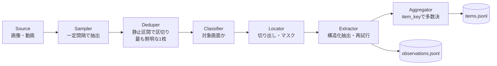

# framelift 設計書

## 概要

framelift は、画面収録やスクリーンショットから、利用者が定義したスキーマどおりの構造化データを取り出す Python ライブラリと CLI。読み取りには画像対応の LLM を使う。特定のゲームやアプリには依存しない。利用者は「何を読み取るか（Pydantic モデル）」と「どう読むか（指示と検証）」を `Profile` として渡すだけでよい。

ゲームの自動操作やクライアントへの介入は行わない。自分で撮った画面を後から読むだけのツール。最初の利用者は作者の別プロジェクト（非公開）で、0.x の間は、そこで実際に必要になった機能だけを入れる。

## 使い方のイメージ

1.0 時点の完成形のイメージ。0.2 で使えるのは `name`・`version`・`output_type`・`instructions`・`validators`・`item_key` と、画像・動画の入力までで、それ以外の引数はコメントの版で足す。

```python
from pydantic import BaseModel, Field
from framelift import Profile, Pipeline


class ShopItem(BaseModel):
    name: str = Field(description="商品名")
    price: int = Field(description="価格（整数）", gt=0)


class ShopScreen(BaseModel):
    shop_name: str
    items: list[ShopItem]


shop = Profile(
    name="fantasy-shop",
    version="1",
    output_type=ShopScreen,
    instructions="ショップ画面の商品一覧を、表示どおりに読み取ってください。",
    screen_description="ショップの商品一覧画面",  # 0.3
    item_key=lambda item: item.name,
    locate="model",  # 0.3。full | fixed | model
    redact=[(0.0, 0.85, 1.0, 1.0)],  # 0.3。送信前に塗りつぶす領域（相対座標）
)

pipeline = Pipeline(shop, model="anthropic:<model>", out_dir="out/")
pipeline.run(["recording.mp4", "shots/*.png"])
# → out/observations.jsonl（フレーム単位）と out/items.jsonl（集約後）
```

```bash
framelift run recording.mp4 --profile myprofiles:shop --model anthropic:<model> --out out/
```

## 設計

### Profile — 唯一の拡張点

読み取り対象は `Profile` で定義する。項目は、それを使う機能と同じ版で足す。

| 項目 | 役割 | 版 |
| --- | --- | --- |
| `output_type` | 出力の Pydantic モデル。フィールドの説明はモデルへの指示として渡る | 0.0.1 |
| `instructions` | 読み方の指示 | 0.0.1 |
| `validators` | 出力を検査し、問題があれば `ModelRetry` を投げる関数。Pydantic AI の出力検証に登録し、再試行させる | 0.0.1 |
| `version` | 指示やモデル定義を変えたら上げる。キャッシュと評価結果の識別に使う | 0.0.1 |
| `item_key` | 一覧の各項目を同一視するキー。評価で正解の項目と対応付けるのと、複数フレームの集約に使う。`output_type` のトップレベルにある、ただ 1 つの `list[モデル]`（`| None` も可）型のフィールドの要素に適用する | 0.1 |
| `screen_description` | 対象画面の説明（画面判定に使う） | 0.3 |
| `locate` / `redact` | 切り出し方と、送信前に塗りつぶす領域 | 0.3 |

公開 API として約束するのは、`Profile` と `Pipeline` の設定項目だけ。パイプラインの各段のインターフェースは、0.x の間は内部扱い（`framelift._internal`）にし、利用者から要望が出てから公開する。使われない拡張点を先に約束して、設計が固まらなくなるのを避けるため。

### パイプライン



0.2 で実装済みなのは Source（画像・動画）、Sampler、Deduper、Extractor、Aggregator と、`observations.jsonl`・`items.jsonl` の書き出し。

#### 入力

画像ファイル群と動画ファイルを受け付ける。動画は拡張子（`.mp4`・`.mov`・`.m4v`・`.mkv`・`.webm`）で見分け、PyAV でデコードする。PyAV は wheel に FFmpeg が同梱されているので、利用者に FFmpeg の別途インストールを求めずに済み、合成動画でのテストもしやすい。動画入力は `framelift[video]` の extras に分け、画像だけを使う人の依存を軽くする。動画があるのに extra がなければ、モデルを呼ぶ前に案内付きで止める。各入力の sha256 を計算し、出所として記録する。動画はファイル全体を読み込まず、少しずつ読んで計算する。動画のハッシュはデコードの前に計算し、デコードしたあとに照合し直さないので、その間にファイルが差し替えられると、記録した sha256 とデコードした中身が食い違う。

#### フレーム抽出と重複除去

シーン検出フィルタには頼らず、一定間隔（既定は毎秒 4 フレーム、`frame_rate`）で標本を取り、画面が止まっている間を 1 つの区間にまとめる。区間の中から、ラプラシアン分散が最大の、つまり最もブレていない標本を代表に選び、モデルに送る。スクロール中のブレたフレームを抽出に回さないため。

- 静止の判定には、標本を 256×256 のグレースケールに縮小し、16×16 のタイルに分けて、平均絶対差が 3（0〜255）を超えたタイルの割合を使う。直前の標本との割合と、区間の先頭の標本との割合がどちらも `motion_threshold`（既定 0.05）以下なら同じ区間に加え、どちらかが超えたら区間を切る。先頭とも比べるのは、ゆっくりしたスクロールは隣どうしの差が小さいまま画面が入れ替わるため
- 画面全体の平均ではなく、変化したタイルの割合で判定するのは、配置が同じで文字だけが変わる切り替わりを見逃さないため。行の背景の縞がそろう行数のスクロールや、ページ・タブの切り替えがこれに当たる。全体の平均だと、文字の差が平均の中に埋もれてしまう。一方、隅の小さなアニメーションや時計、1 行だけの書き換えは変化したタイルが少ないので、静止の区間を切らない。合成画面では、行単位のスクロールやページの入れ替えで 10% 以上のタイルが変わり、符号化ノイズ・小さなアニメーション・1 行の書き換えは 2% 未満だった
- pHash は、少しずれた画面やブレた画面も近いと判定するので、静止の判定には使わない。移動を挟んだ 2 つの静止区間は、pHash が近くても別の区間として扱う。pHash は観測記録に残すためだけに計算する
- 標本が 2 つ未満の区間（移動中の単独の標本など）は捨てる。このため、標本が 2 つ以上入らないほど短く表示された画面は読まれない
- 数ピクセルのずれでも文字がタイルをまたいで動くので、ゆっくりしたスクロールも動きとして扱い、その間の標本は読まない。止まらずに動き続ける画面は、動画全体で最も鮮明な標本 1 枚だけになる（下記）ので、読みたい画面では指を止める
- 最後のフレームは、動画の終わりまで表示されているものとして数える。終わりの時刻は、フレームの長さ、ストリームの長さ、コンテナの長さの順に取る。画面が変わったときだけフレームを書く可変フレームレートの録画では、最後の静止画面がフレーム 1 枚になるため
- 静止区間が 1 つもない動画は、最も鮮明な標本を 1 枚だけ読む
- 動画の表示回転（`frame.rotation`）を適用してから判定し、送る
- 区間を閉じたらすぐ代表を渡すので、長い動画でもメモリの使用量は一定になる
- モデルを呼ばずに代表フレームだけを確かめる `framelift frames` を用意する

#### 画面判定

`screen_description` をもとに、縮小した画像で「対象画面かどうか（bool）と確信度」を軽いモデルに返させる。判定結果は pHash をキーにキャッシュする。テンプレート照合など、LLM を使わない判定関数に置き換えることもできる。

#### 切り出しと塗りつぶし

外部に送る前に、対象のパネルだけを切り出し、`redact` で指定した領域を塗りつぶす。

| 戦略 | 内容 |
| --- | --- |
| `full` | 切り出さない。画面全体を送るので、明示的に指定したときだけ使える |
| `fixed` | 画面の向き（縦・横）ごとに、相対座標で切り出す |
| `model` | 縮小した画面から、正規化座標の bbox をモデルに返させ、元の解像度で切り出す |

#### 構造化抽出

Pydantic AI の `Agent` に、`output_type` と切り出した画像（`BinaryContent`）を渡す。`validators` は出力検証として登録し、`ModelRetry` で再試行させる（上限回数は `Pipeline` の `max_retries`）。再試行を使い切った画像は `status: "error"` として記録し、1 枚の失敗で全体は止めない。読めない画像・動画も `status: "error"`、`frame: null` の観測として記録して次の入力へ進み、壊れる前に読めたフレームの結果は残す。途中で壊れている動画、フレームが 1 つもない動画、権限がない・途中で消えたなどでファイルを開けないものもこれに含む。ファイルを開けなければ `source.sha256` も null にする。モデルは `"provider:model"` の文字列で指定し、差し替えられる。トークン使用量と処理時間を記録する。

結果は「切り出し画像のハッシュ・モデル名・`Profile.version`」をキーにローカルにキャッシュし、再実行や評価の繰り返しで同じ画像に課金しない。

#### 集約

スクロールした一覧では、同じ項目が複数のフレームに映る。1 回の実行の、検証を通ったすべての観測（動画・静止画をまたぐ）から、`item_key` で項目を束ね、多数決を取る。各項目には根拠になったフレームの一覧を付け、1 枚にしか映らなかった項目は `votes: 1` で区別できるようにする。

- `votes` は項目が映ったフレームの数。1 フレームに同じキーが 2 回あれば、最初の 1 つだけを使う
- キーは JSON にした形で束ねる。`Enum` とその値のように、JSON にすると同じになるキーは 1 つの項目になる。JSON にできないキーは `str(key)` で書き出すが、束ねるのはキーそのもので行う。文字列にすると同じになるだけの別のキーを 1 つにまとめないため
- 項目の値は、観測記録と同じく出力モデル自身のシリアライズ設定で書く。別名（alias）で書き出すモデルなら、`items.jsonl` も別名になる
- `item_key` が例外を投げた項目は集約から外し、件数を `RunResult.unkeyed_items` に数える。正常に返した `None` は有効なキー
- 項目がすべて dict ならフィールドごとに、そうでなければ（`RootModel` の項目など）項目全体で投票する。フィールドがない観測は棄権し、明示的な `null` は 1 票に数える
- 最多票が同数で並んだら決め打ちせず、そのフィールドを null にする。値が 2 種類以上あったものは、最多票が決まった場合も `conflicts` に全候補と票数を残す（票数の多い順、同数なら値の順）
- `item_key` がない `Profile` では集約しない
- モデルの呼び出しが検証の失敗以外のエラー（プロバイダの拒否など）で止まった場合も、それまでに読んだ分の `items.jsonl` を書いてから例外を投げる。`observations.jsonl` と同じく、途中までの結果を残すため

### 出力形式

スキーマにはバージョンを付ける。形式を変えるときは版（`v1` の部分）を上げる。

`observations.jsonl`（画像・フレーム単位）は 0.2 で `framelift/observation/v2` にした。v1 からの変更は、`source.phash` を、モデルに送った画像を表す `frame` に移したこと。

```jsonc
{"schema": "framelift/observation/v2",
 "status": "ok",
 "profile": {"name": "fantasy-shop", "version": "1"},
 "source": {"path": "recording.mp4", "sha256": "..."},
 "frame": {"index": 3, "timestamp_ms": 2250, "sha256": "...", "phash": "..."},
 "data": {"shop_name": "...", "items": [...]},
 "error": null,
 "model": "anthropic:<model>",
 "usage": {"input_tokens": 1534, "output_tokens": 96, "requests": 1, "latency_ms": 2100},
 "retries": 0}
```

- `source` は入力ファイル（画像か動画）
- `frame` はモデルに送った画像。`index` は入力ファイル内で選んだフレームの通し番号、`sha256` は送った PNG のバイト列のハッシュ
- `timestamp_ms` はストリームの先頭からの時間。開始時刻が 0 でない mov・mkv・webm でも、最初のフレームが 0 近くになる
- 静止画では `index: 0`、`timestamp_ms: null` で、`frame.sha256` は `source.sha256` と同じ
- 入力そのものを読めなかったときは、何も送っていないので `frame` は null

切り出しを入れる 0.3 で、版を上げて `crop`（`bbox`）を足す。

`items.jsonl`（集約後）は 0.2 で入れた。`Profile.item_key` があるときだけ書く。

```jsonc
{"schema": "framelift/item/v1", "key": "Moon Herb",
 "data": {"name": "Moon Herb", "price": 120}, "votes": 3,
 "conflicts": [{"field": "price", "values": [{"value": 120, "votes": 2}, {"value": 12, "votes": 1}]}],
 "evidence": [{"source_sha256": "...", "frame_index": 1, "timestamp_ms": 2250},
              {"source_sha256": "...", "frame_index": 2, "timestamp_ms": 5300},
              {"source_sha256": "...", "frame_index": 3, "timestamp_ms": 8100}]}
```

`conflicts` の `field` は、項目全体で投票したときは null になる。`evidence` は票を入れたフレームごとに 1 件で、件数は常に `votes` と同じ。パスは入れず、ハッシュだけを残す。

出力時に、パスを落として sha256 だけを残す匿名化を選べる（`Pipeline(anonymize_paths=True)`）。読めない入力のエラー文も、パスを含めずに原因だけを書く（「Not a readable image (No such file or directory)」など）。パスを置換で消す方式だと、エスケープされた形のパスが残り、短いパスでは文言まで書き換えてしまうため。

### 評価ハーネス

`pydantic-evals` の上に、画像と正解のデータセット形式、評価器、設定の総当たり比較を用意する（`framelift[eval]`）。データセット形式と評価器は 0.1 で実装済み。

- データセット — YAML で書く。各ケースは、画像（データセットのルートからの相対パス）、sha256、正解（必須フィールドはすべて書く。既定値のあるフィールドは省いてよい）、メタデータ（画面の向き・端末・解像度など）を持つ。画像のパスはデータセットファイルのディレクトリからの相対で、`--root` で別のディレクトリを指せるので、画像をリポジトリに置かない運用ができる。あるデータセット用に設定したルートが別のデータセットにも気づかれないまま効いてしまうので、環境変数は使わない。実行前に全画像を読み込み、画像として読めることと sha256（大文字・小文字は区別しない）を照合し、問題はまとめて報告する
- 評価器 — 下の表のとおり。結果は pydantic-evals のレポートとして端末に出す
- 総当たり比較（0.3） — `matrix.yaml` で「モデル×切り出し戦略×指示の版」を総当たりで実行し、比較表を Markdown で出力する。README にそのまま貼れる形にする

```yaml
schema: framelift/dataset/v1
cases:
  - name: shop-000
    image: shop-000.png
    sha256: 3dbb5bc8...
    expected:
      shop_name: Amber Market
      items:
        - {name: Dew Rope, price: 1590}
    metadata: {orientation: portrait, width: 720, height: 1280}
```

| 評価器 | 内容 |
| --- | --- |
| `ValidationPassed` | 再試行の上限までに検証を通ったか（検証の通過率） |
| `FieldAccuracy` | 正解に書いたフィールドだけを葉の値で比べた一致率。一覧は `item_key` で対応付けた項目どうしを比べ（同じキーの項目は出現順に対応付ける）、出力にない項目の値は不一致と数える。`item_key` がないとき、または正解が空の一覧のときは、一覧全体を 1 つの値とし、位置ごとに正解に書いたフィールドを比べる。不一致のパスを理由に残す |
| `item_precision` / `item_recall` | 一覧項目の適合率と再現率（`item_key` で正解と対応付け）。`item_key` があり、正解に一覧があるときだけ出す |
| `input_tokens` / `output_tokens` / `latency_ms` / `retries` | コストと処理時間。コストはトークン量で比べ、金額には換算しない |

正解は実行前に `output_type` 全体で（バリデータ・シリアライザ・設定も含めて）検証し、出力と同じ JSON 形式に揃える。必須フィールドはすべて書き、既定値のあるフィールドだけ省いてよく、省いたフィールドは比べない。出力に含まれない `Field(exclude=True)` のトップレベルのフィールドは、検証には使うが比べない。必須フィールドを省けないのは、一部だけの正解には出力モデルのバリデータや設定を正しく適用できず、出力側と値やキーが食い違うため。足りない必須フィールド、型の合わない値（引用符のない YAML の `no` が `False` になる場合など）、モデルバリデータが拒否する値、出力に現れないキー（誤記・未知のフィールド・入れ子の除外フィールド。Union や `extra="allow"` のモデルも、検証後の出力を書き出した形で判定する）、`item_key` が例外を出す項目は、データセットのエラーとして実行前にまとめて報告する。抽出した項目で `item_key` が例外を出した場合は、評価を止めず、どの正解とも対応しない項目として数える。一覧のシリアライザが並べ替えてもキーと値がずれないよう、一覧の項目はキーも値もそれぞれの項目のモデルから取る。Python では `False == 0` が成り立つので、値の比較では真偽値と数値を別の値として扱う。実行中は、抽出の直前に読んだ画像の sha256 をもう一度照合し、照合後に差し替わった画像はそのケースの失敗にする。

検証を通らなかったケースは、`FieldAccuracy` と適合率・再現率を 0 とする。抽出は pydantic-evals のイベントループ上で非同期に実行し、コストとプロバイダのレート制限を読みやすくするため、ケースは 1 件ずつ順に処理する。失敗の多いモデルが安く見えないよう、検証を通らなかったケースも使ったトークン量と再試行回数を記録する。`framelift eval` は、ケースや評価器が異常終了したときだけ終了コード 1 で終わり、スコアが低いだけなら 0 で終わる。

### 合成サンプル

架空のショップ画面を Pillow で描画し、画像・動画・正解を自動で生成する（`framelift synth`）。架空の店名・商品名・価格で一覧 UI を描き、画面の向き、スクロール、JPEG 圧縮、ノイズ、解像度を変えられるようにする。画像の正解は評価にそのまま使える `dataset.yaml` として書き出す。

動画（`--videos N`）は横向きの画面で、一覧の表示領域は 6 行分の高さで、行が途中で切れない。静止（1.5 秒）と 3 行分のスクロール（0.6 秒、ブレを再現）を最下部まで繰り返すので、隣り合う静止画面には同じ項目が映る。動画の評価は要望が出てから入れるので、動画の正解ファイルは書かない。テストでは生成関数が返す、静止区間ごとの表示項目を使う。

正解が自動で得られるので、公開できる評価データセットとして使える。README には合成データでのベンチマークを載せ、実際の画面での結果は「非公開のデータセットでの集計」として補足する。テスト用の合成動画（スクロールするショップ画面）も同じ生成器で作る。リポジトリに置くサンプル画像は少数（`samples/`）に限り、それ以外は生成スクリプトで再現する。

### プライバシー

処理はローカルで行い、外部に送るのは切り出しと塗りつぶしを済ませた画像だけ。既定の送信ポリシーも「切り出し後の画像のみ」にする。画面には、チャットや他のプレイヤー名など、無関係な個人情報が映るため。切り出しを入れる 0.3 までは、利用者が渡した画像と、動画から選んだフレームをそのまま送る。テレメトリは持たない。Logfire は任意の依存で、既定では無効。キャッシュと出力はローカルのディレクトリにだけ書く。

### テスト

- テストでは `models.ALLOW_MODEL_REQUESTS = False` を設定し、実際のモデルへのリクエストを禁止する
- モデルは `TestModel` や `FunctionModel` に差し替える。`FunctionModel` で「最初は不正な値を返し、`ModelRetry` の後に正しい値を返す」応答を再現し、検証と再試行を確かめる
- フレーム抽出・重複除去・集約は、合成画像と合成動画で検証する
- 実際のモデルを使うテストは `live` マーカーで分け、CI では実行しない

### CLI

Typer で実装する。

| コマンド | 用途 | 版 |
| --- | --- | --- |
| `framelift run <inputs...> --profile pkg.module:obj --model ... --out DIR` | 抽出 | 0.0.1 |
| `framelift synth --out DIR --n 100 [--videos N]` | 合成サンプルの生成（`--videos` は 0.2） | 0.0.1 |
| `framelift eval <dataset.yaml> --profile ... --model ... [--root DIR] [--matrix matrix.yaml]` | 評価（`--matrix` は 0.3） | 0.1 |
| `framelift frames <video> --out DIR [--frame-rate] [--motion-threshold]` | モデルに送る代表フレームと `frames.jsonl` だけを書き出して確認する（デバッグ用） | 0.2 |

### パッケージングとリリース

- ライセンスは MIT
- uv・ruff・ty、`py.typed` 付き。対応 Python は 3.12 以上
- 型チェックは ty（Astral）。Pydantic のモデル（`Field`・`ConfigDict` など）を解釈できる。まだベータの 0.x 系で、リリース間で診断が変わりうるため、バージョンを固定し、Renovate の更新 PR で差分を確認してから上げる。設定は `pyproject.toml` の `[tool.ty]` に置く
- 主な依存は pydantic、pydantic-ai-slim、Pillow、imagehash、numpy、PyYAML、Typer。extras は `video`（PyAV）、`eval`（pydantic-evals）、`anthropic` / `openai` / `google`（各プロバイダ）
- CI は対応 Python のマトリクスで ruff・ty・pytest を実行し、wheel をクリーンな環境に入れて CLI を動かす
- main の `pyproject.toml` の版が変わると、`release.yml` がタグと GitHub Release を作り、GitHub Actions から Trusted Publishing で PyPI に公開する（秘密情報を持たない）
- 0.x 系で、破壊的変更を許す。CHANGELOG は Conventional Commits をもとに書き、依存は Renovate で追随する
- README は英語にする（OSS として読まれる範囲を広げるため）。CONTRIBUTING に、対応は不定期であることを明記している

## マイルストーン

| 版 | 内容 |
| --- | --- |
| 0.0.1 | 画像入力、構造化抽出（検証・再試行）、`observations.jsonl`、合成サンプル（静止画）、CLI の `run`・`synth`（実装済み） |
| 0.1 | 評価ハーネス（データセット形式、項目単位の評価器、`framelift eval`）、`Profile.item_key`、synth の `dataset.yaml`（実装済み） |
| 0.2 | 動画入力、フレーム抽出と重複除去、集約と `items.jsonl`、合成動画、観測記録 v2（実装済み） |
| 0.3 | 画面判定、切り出し（`model` / `fixed`）と塗りつぶし、キャッシュ、総当たり比較 |
| 1.0 | 最初の利用者での運用を経て、公開 API を確定 |

## 決定事項

- 動画のデコードは PyAV（wheel に FFmpeg が同梱され、利用者の追加インストールが不要。テストもしやすい）
- 画面の切り替わりは「一定間隔の抽出＋縮小画像のタイルのうち変化した割合による静止判定」で検出し、区間内で最も鮮明なフレームを採用する（スクロール中のブレたフレームを避け、依存も少ない）。当初は pHash の差で区切る予定だったが、pHash はずれやブレに強く作られているので、スクロール中の標本と静止画面を区別できなかった。画面全体の平均差も、配置が同じで文字だけが変わる切り替わりを見逃したので、タイル単位にした
- 既定の送信ポリシーは切り出し後の画像のみ（無関係な個人情報を外部に送らない）
- 公開 API は `Profile` と `Pipeline` の設定に限る（使われない拡張点を 0.x のうちに約束しない）
- 合成サンプルの生成器を同梱し、公開ベンチマークに使う（実画面を公開せずに評価結果を示せる）
- 抽出結果を画像ハッシュ・モデル・`Profile.version` で永続キャッシュする（評価の反復で同じ画像に課金しない）
- ライセンスは MIT（最も簡潔で、個人の OSS として利用者に説明しやすい）

## リスク

| 重大度 | リスク | 対応 |
| --- | --- | --- |
| 高 | 画像対応 LLM の読み誤り（特に数値） | 検証と再試行、複数フレームの多数決、票割れは `conflicts` として残す。評価で誤りの傾向を測る |
| 中 | 汎用化の先回りで API が膨らむ | 公開 API は `Profile` と `Pipeline` の設定だけ。各段のインターフェースは内部扱い |
| 中 | 抽出コスト | 重複除去、画面判定による絞り込み、切り出し、キャッシュ。usage を記録し、評価でコストを比較 |
| 中 | Pydantic AI やプロバイダの API 変更 | Renovate で追随し、テスト用モデルでのテストで早期に検出 |
| 低 | ty がベータで、更新により診断が変わる | バージョンを固定し、更新 PR で新しい指摘を確認してから上げる |
| 低 | PyAV の wheel がない環境 | 動画入力は extras に分け、画像入力だけでも使える |
